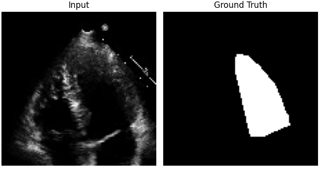
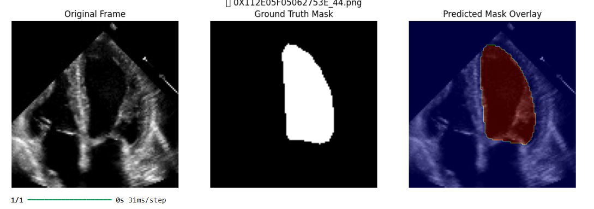
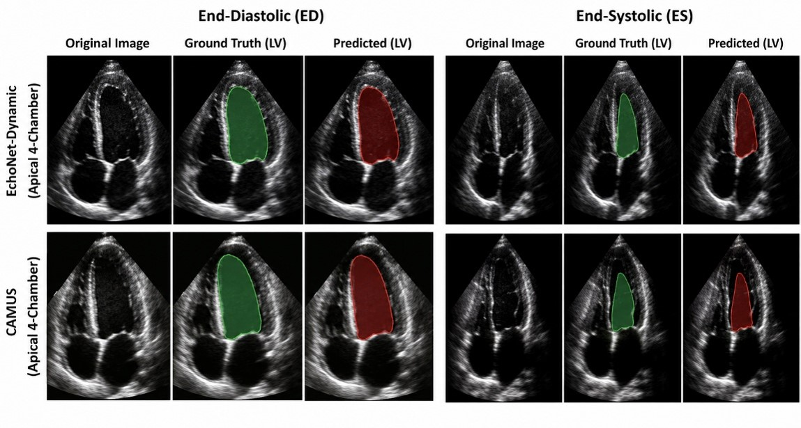
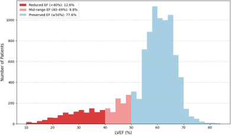
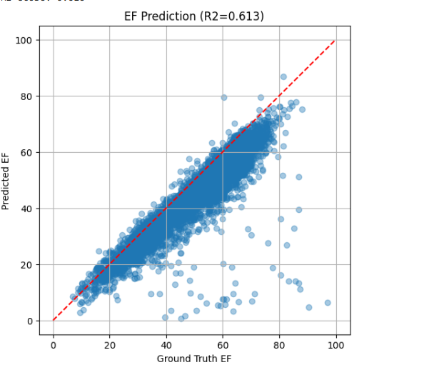
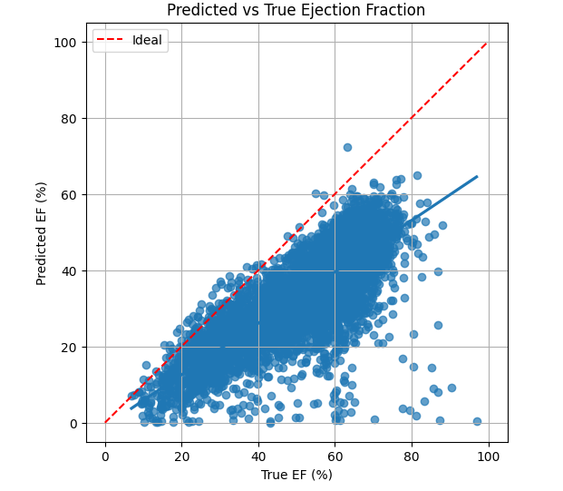
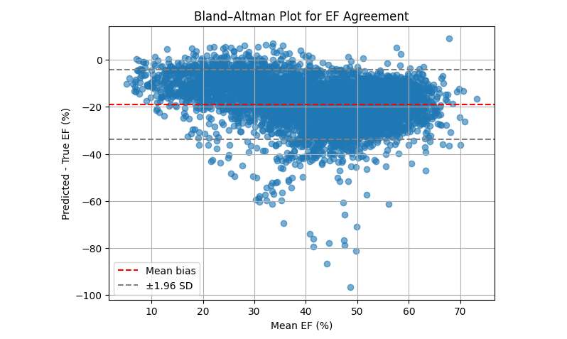
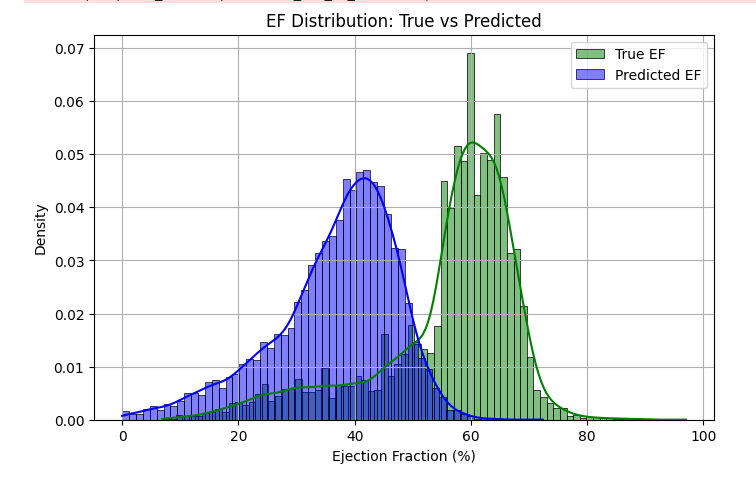
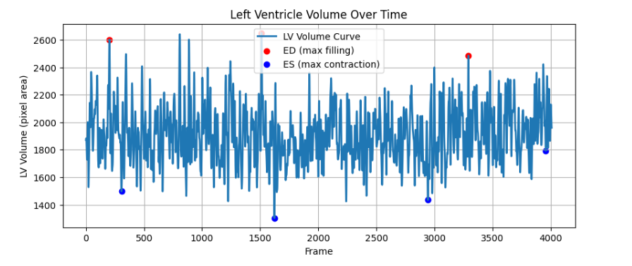
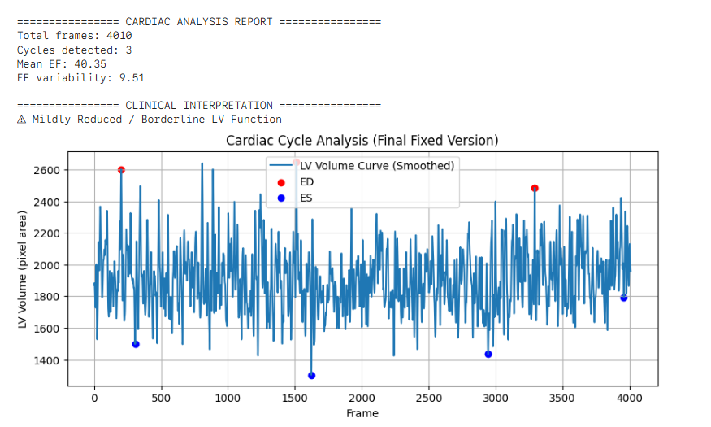

# Explainable Cardiac AI

### Echocardiography Analysis using Deep Learning, Explainable AI and Large Language Models

\<p align="center">
&#x20; \
&#x20; \
&#x20; \
&#x20; \
\</p>

## Overview

**Explainable Cardiac AI** is an academic research project focused on automated analysis of echocardiography videos using artificial intelligence and deep learning.

The project explores Left Ventricle (LV) segmentation, cardiac cycle analysis, Ejection Fraction (EF) estimation, explainability techniques, and language-model-based clinical report generation.

The research combines computer vision, deep learning, temporal analysis and generative AI to investigate an integrated workflow for echocardiographic analysis.

## Research Objectives

- Preprocess echocardiography videos and extract relevant frames.
- Develop deep learning approaches for Left Ventricle segmentation.
- Explore cardiac cycle analysis and End-Diastolic (ED) and End-Systolic (ES) frame identification.
- Estimate Ejection Fraction from ventricular measurements.
- Investigate explainability techniques for interpreting model predictions.
- Explore structured clinical report generation using a Large Language Model.

## Research Workflow

The project is organized into six major research stages.

| Stage | Research component    | Description                                                       |
| ----- | --------------------- | ----------------------------------------------------------------- |
| 01    | Data preprocessing    | Video processing, frame extraction and preparation                |
| 02    | LV segmentation       | U-Net-based and other deep learning segmentation experiments      |
| 03    | EF estimation         | Cardiac phase analysis and EF estimation experiments              |
| 04    | Explainable AI        | Grad-CAM-based visualization experiments                          |
| 05    | CAMUS experiments     | Additional echocardiographic segmentation experiments             |
| 06    | LLM report generation | Structured report generation using extracted cardiac measurements |

## Methodology

### 1. Echocardiography preprocessing

Echocardiography videos are processed to prepare image frames for subsequent deep learning experiments.

### 2. Left Ventricle segmentation

Deep learning architectures are investigated for segmenting the Left Ventricle from echocardiographic images.

The segmentation experiments include U-Net-based approaches and other architectural variations.

### 3. Cardiac analysis and EF estimation

The segmentation and cardiac analysis experiments investigate:

- End-Diastolic (ED) and End-Systolic (ES) frame identification.
- Changes in ventricular measurements over time.
- Ejection Fraction estimation using experimental measurement-based approaches.

### 4. Explainable AI

Grad-CAM-based experiments are explored to visualize model attention and investigate the interpretability of deep learning predictions.

### 5. CAMUS experiments

Additional segmentation experiments are conducted using the CAMUS echocardiography dataset to explore model behavior on another dataset.

### 6. LLM-based clinical report generation

A report-generation prototype explores the use of **Mistral-7B-Instruct** to generate structured summaries from extracted cardiac measurements.

The report-generation component is an experimental research prototype and is not a clinically validated reporting system.

## Repository Structure

```text
Explainable-Cardiac-AI/
│
├── data/
│   └── README.md
│
├── notebooks/
│   ├── 01_data_preprocessing/
│   │   ├── echonet_dynamic_image_and_mask_extractor.ipynb
│   │   └── processing.ipynb
│   │
│   ├── 02_lv_segmentation/
│   │   ├── echo-unet-convlstm-kaggle.ipynb
│   │   ├── ecohnet-dynamic-segmentation-resnet50unet-imagenet.ipynb
│   │   ├── ecohnet_dynamic_segmentation_resnet50unet_imagenet.ipynb
│   │   ├── final.ipynb
│   │   ├── segmenatation.ipynb
│   │   └── segmentation-final.ipynb
│   │
│   ├── 03_ef_estimation/
│   │   └── ef-range.ipynb
│   │
│   ├── 04_explainable_ai/
│   │   └── cardiac-xai.ipynb
│   │
│   ├── 05_camus_experiments/
│   │   ├── camus-echocardiographic-image-segmentation.ipynb
│   │   └── camus-segmentation.ipynb
│   │
│   └── 06_llm_report_generation/
│       └── llm_report.ipynb
│
├── results/
│   ├── ef_estimation/
│   ├── report_generation/
│   └── segmentation/
│
├── .gitignore
├── README.md
└── requirements.txt
```

## Experimental Results and Visualizations

The following visualizations are available in the repository.

### 1. Left Ventricle Segmentation

\<p align="center">   \ \</p>

\<p align="center">   \   \ \</p>

### 2. Cardiac Analysis and EF Estimation

\<p align="center">   \   \ \</p>

\<p align="center">   \   \ \</p>

\<p align="center">
&#x20; \
&#x20; \
\</p>

### 3. LLM-Based Report Generation

\<p align="center">   \ \</p>

\<p align="center">   \ \</p>

## Datasets

This research uses:

- **EchoNet-Dynamic** – Echocardiography video dataset for cardiac analysis and LV segmentation experiments.
- **CAMUS** – Echocardiography dataset for additional segmentation experiments.

Original datasets and patient-related data are not included in this repository.

Users must obtain authorized access from the respective dataset providers and comply with their licensing, access and usage requirements.

Refer to [`data/README.md`](data/README.md) for further information.

## Technologies Used

| Category            | Technologies                                                         |
| ------------------- | -------------------------------------------------------------------- |
| Programming         | Python                                                               |
| Deep Learning       | PyTorch, TensorFlow, Keras                                           |
| Computer Vision     | OpenCV, Pillow                                                       |
| Image Processing    | Albumentations, Scikit-image                                         |
| Data Processing     | NumPy, Pandas, SciPy                                                 |
| Machine Learning    | Scikit-learn                                                         |
| Visualization       | Matplotlib, Seaborn                                                  |
| Model Architectures | U-Net, ResNet50-based segmentation experiments, ConvLSTM experiments |
| Explainability      | Grad-CAM                                                             |
| Generative AI       | Hugging Face Transformers, Mistral-7B-Instruct                       |
| Development         | Jupyter Notebook, Git, GitHub                                        |

## Installation

Clone the repository:

```bash
git clone https://github.com/Harshithabhaskaran/Explainable-Cardiac-AI.git
cd Explainable-Cardiac-AI
```

Install the listed dependencies:

```bash
pip install -r requirements.txt
```

Launch Jupyter Notebook:

```bash
jupyter notebook
```

**Note:** The notebooks represent different research experiments and may require different dataset paths, model checkpoints, hardware configurations and dependency versions. The original datasets and trained model weights are not distributed with this repository. GPU and framework compatibility should be configured according to the individual experiment.

## Research Scope and Limitations

- This repository contains research notebooks and experimental visualizations rather than a fully packaged production application.
- Different notebooks investigate different architectures and experimental approaches; they should not be interpreted as a single fully validated deployment pipeline.
- EF estimation results depend on the measurement approach and evaluation protocol.
- CAMUS experiments are exploratory and should not be interpreted as proof of clinical generalization.
- Explainability visualizations are experimental and do not establish clinical validity.
- LLM-generated reports are research outputs and require independent clinical verification.

**This project is intended for academic research and educational purposes only. It is not a medical device and must not be used for clinical diagnosis or treatment decisions.**

## Future Work

- Improve temporal consistency in cardiac segmentation.
- Strengthen quantitative evaluation and external validation.
- Investigate more robust cardiac measurement approaches.
- Improve explainability and interpretation of model predictions.
- Explore Retrieval-Augmented Generation (RAG) for evidence-grounded clinical report generation.
- Develop a reproducible and integrated research demonstration.

## Author

**B. Harshitha**
M.Tech – Computer Science and Engineering (AI & ML)
Vellore Institute of Technology, Vellore

- **GitHub:** [Harshithabhaskaran](https://github.com/Harshithabhaskaran)
- **Portfolio:** [Harshitha's Portfolio](https://harshithabhaskaran.github.io/Harshitha_Portfolio/)

---

*Academic research project exploring artificial intelligence for echocardiography analysis, cardiac measurements, explainability and clinical report generation.*
